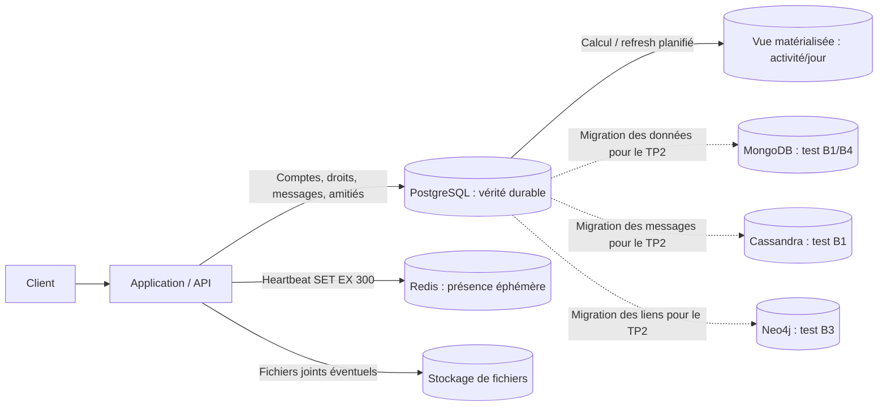

# Architecture du TP2 Discord

Après les tests, je garde **PostgreSQL + Redis** pour ma version simple. PostgreSQL s'occupe des données importantes et Redis des présences qui expirent au bout de 5 minutes.

- **PostgreSQL** garde les comptes, les salons, les membres, les messages, les amitiés et les droits. C'est la base principale.
- **Redis** garde un statut temporaire avec une clé qui expire après **300 secondes**. Si Redis redémarre, les présences peuvent être perdues, mais les utilisateurs les recréent en revenant.
- Pour les **statistiques**, j'ai une vue matérialisée dans PostgreSQL. Elle est rapide mais il faut la mettre à jour.
- **MongoDB, Cassandra et Neo4j** m'ont servi pour les comparaisons du TP. Je n'ai pas besoin de les ajouter à la version simple.

Pour le TP2, j'ai copié les données vers ces autres bases avec des scripts Python, pas avec une synchronisation en temps réel. Si je voulais garder plusieurs bases en production, il faudrait prévoir comment les mettre à jour sans perdre de données.

Je n'ai pas activé de cache Redis pour les 50 derniers messages, car je n'ai pas fait de benchmark de ce cache. Les résultats détaillés sont dans `MESURES.md`.
