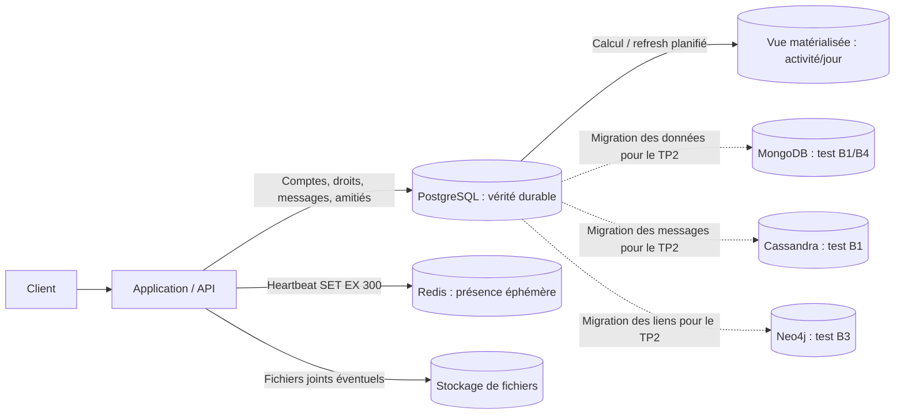

# Architecture mise à jour — TP2 Discord miniature

**Cible minimale après les mesures : deux moteurs, PostgreSQL + Redis.** MongoDB, Cassandra et Neo4j servent ici de moteurs comparatifs dans Docker ; leurs copies de données ne sont **pas** des sources de vérité métier concurrentes.

- PostgreSQL est responsable des entités métier et des autorisations. Un envoi vérifie le membre et le salon textuel avant enregistrement.
- Redis détient seulement la présence courante : clé expirant après **300 secondes** depuis le dernier heartbeat. Un statut perdu à cause d'une panne Redis est temporaire et peut être reconstruit à la prochaine activité.
- La vue d'activité dans PostgreSQL est **une copie calculée**, à rafraîchir. Les messages PostgreSQL restent la source du calcul.
- Le cache Redis des 50 derniers messages est **une idée, pas une fonctionnalité benchmarkée ou déployée** dans ce TP. Une éventuelle copie devrait être invalidée après chaque modification/suppression.
- Aucun transfert automatique par Kafka, CDC ou outbox n'a été réalisé : dans ce TP, les données des moteurs comparatifs ont été chargées par script depuis PostgreSQL. En production, la propagation vers une projection se ferait après commit avec reprise/idempotence et vérification des écarts.

**Pourquoi seulement ces deux moteurs ?** Sur les 300 000 messages étudiés, PostgreSQL sert les 50 derniers rapidement avec un index. Redis simplifie l'expiration de la présence. MongoDB, Cassandra et Neo4j n'ont pas montré un avantage suffisant pour justifier leur exploitation dans cette miniature. Les limitations du benchmark et les seuils de révision figurent dans `DOSSIER_ARCHI.md`.
