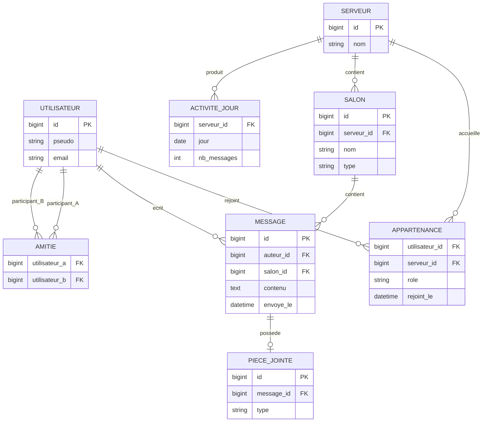

# MCD - Mon Discord miniature

Ce schéma montre les données principales et leurs relations. Je l'ai fait à partir du MCD du TP1 (page 2). Ce n'est pas exactement le schéma SQL du TP2 : ici, on parle surtout des relations entre les éléments.

J'ai mis le rôle dans l'appartenance, et chaque amitié est enregistrée une seule fois. Dans le MCD, les pièces jointes sont séparées du message. Dans le vrai SQL du TP2, j'ai finalement utilisé un champ JSONB pour les pièces jointes et j'ai ajouté `proprietaire_id` dans `serveur`, avec des triggers pour éviter les incohérences. Je l'explique dans `DOSSIER_ARCHI.md`.
